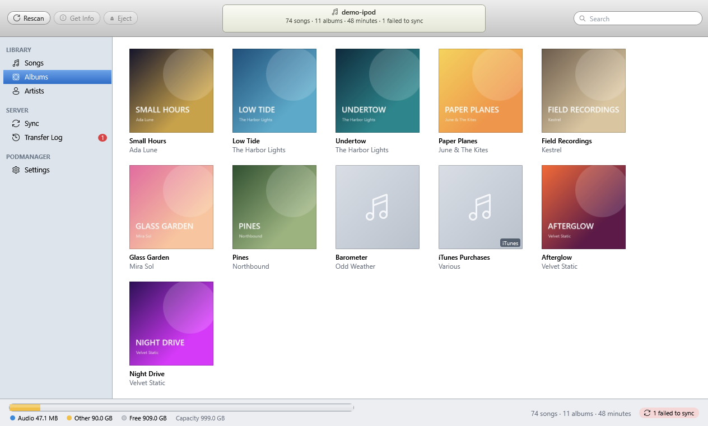
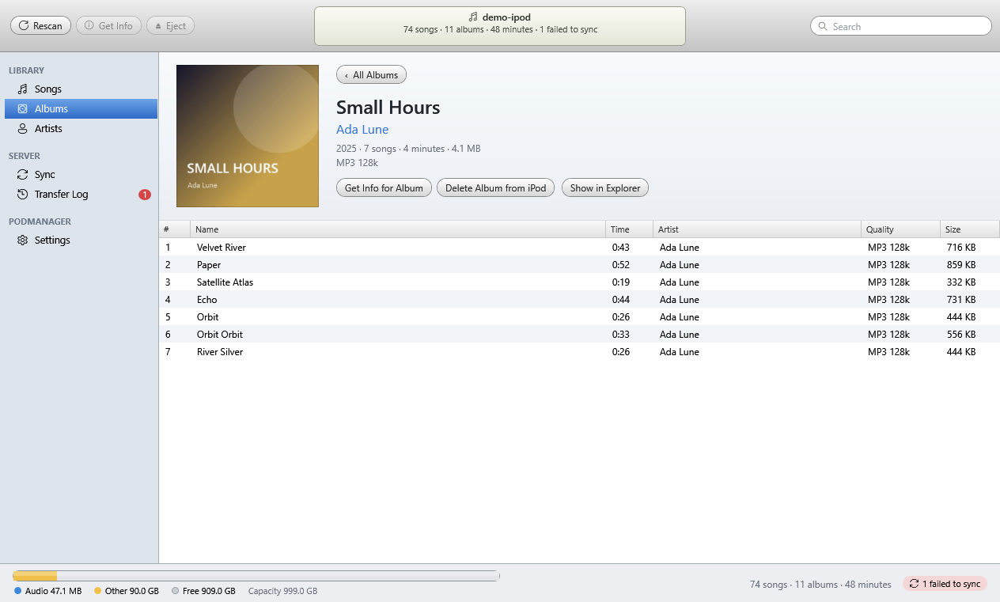
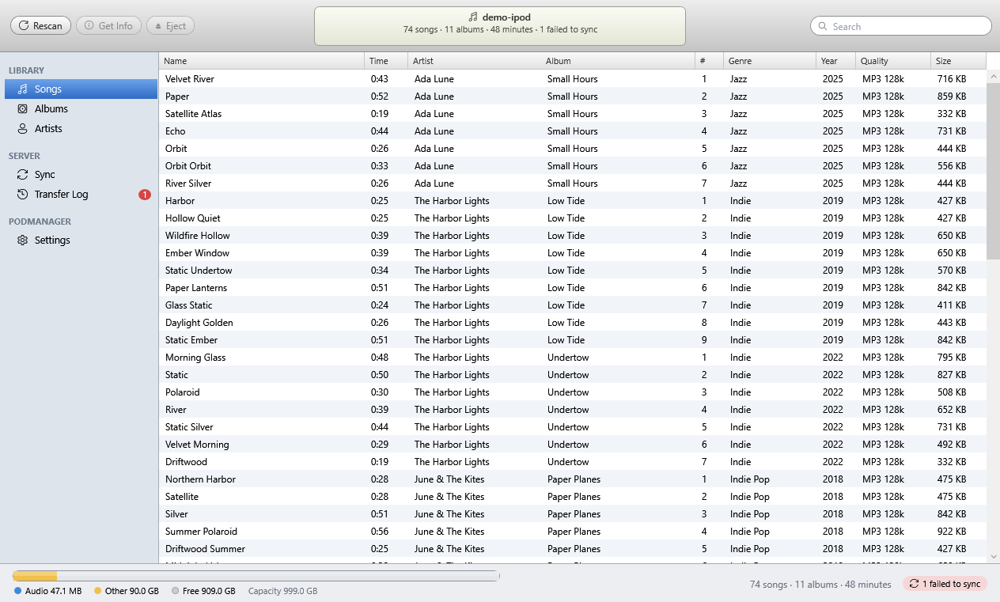
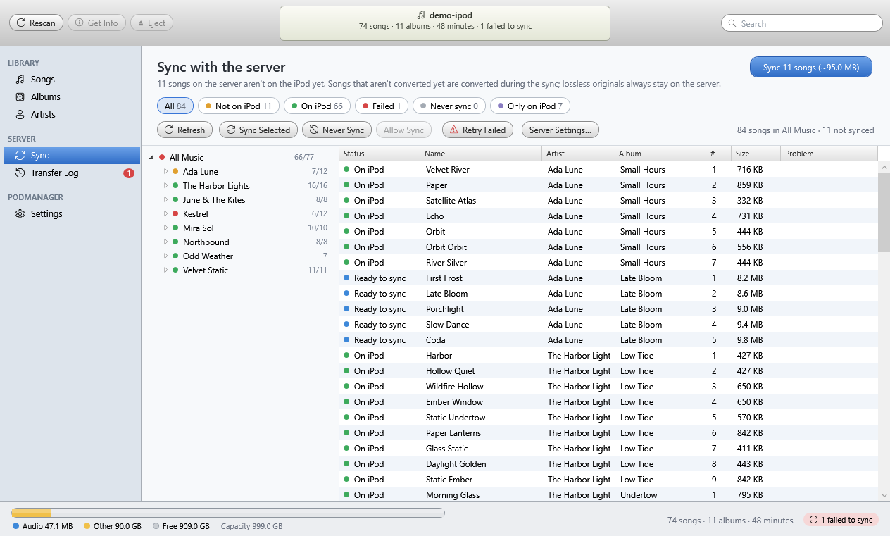
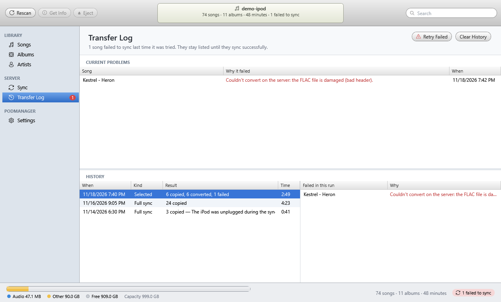
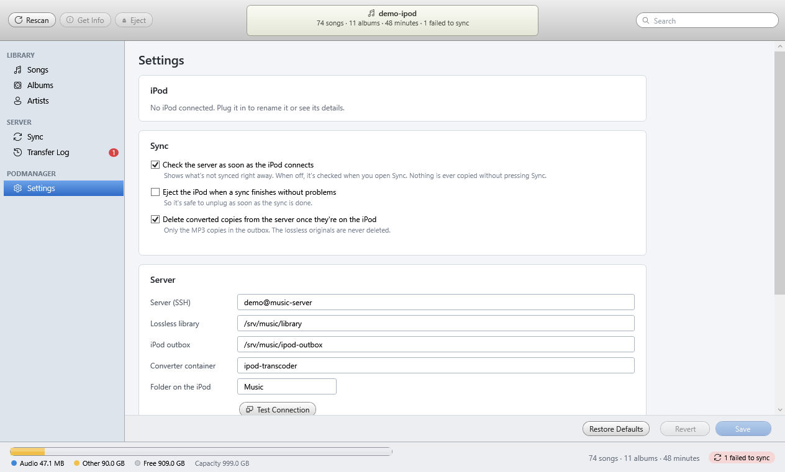
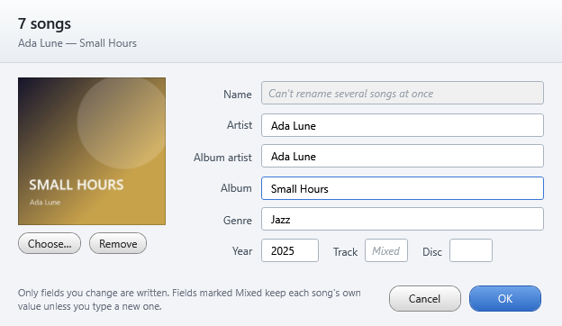

# PodManager

An iTunes-style Windows app for an iPod Video (5th gen) running [Knurl](https://github.com/akbyrner/knurl-ipod),
a hand-rolled replacement firmware. PodManager reads the music straight off the iPod's drive, with no iTunes
database involved, and syncs it from a lossless library on a home server over SSH.

Connect the iPod by sliding HOLD on and then plugging it in: Knurl's disk mode shows the drive to Windows.



| | |
| --- | --- |
|  |  |
|  |  |
|  |  |

All screenshots use the built-in demo library (`--make-demo`) and a made-up server listing.

## Features

- **Songs / Albums / Artists**: browse with album art, search and sort; double-click an album to open it.
- **Get Info** (Ctrl+I): edit title, artist, album artist, album, genre, year, track, disc and artwork, for
  one song or many at once. The changes are written into the files on the iPod.
- **Delete from iPod** (Del): removes the files and any album or artist folders left empty.
- **Sync**: compares the whole server library with the iPod and shows every song's state: On iPod,
  Not synced, Ready, Update ready, Failed (with the reason), Never sync, Only on iPod. An artist/album tree
  rolls the counts up.
  - **Sync** copies everything that's missing.
  - **Sync Selected** copies the selected songs or the selected artist/album.
  - **Never Sync** / **Allow Sync** manage what's excluded.
  - Songs that aren't converted yet are converted on the server during the sync.
  - Nothing syncs automatically: a sync only happens when you press a button.
- **Transfer Log**: every sync, with what was copied, converted and failed, and *why* each failure
  happened. Failed songs stay listed (flagged in Sync, with a badge in the sidebar) until they sync;
  **Retry Failed** tries them again.
- **Settings**:
  - Rename the iPod (its FAT32 drive label, up to 11 characters) and see its model, firmware (the build
    date of `.knurl\knurl.ipod`) and free space.
  - Sync options: check the server on connect, eject after a clean sync, delete delivered copies from the
    outbox.
  - The server connection (SSH address, library and outbox paths, converter container, iPod music folder),
    with **Test Connection**.
  - Open the data folder; clear the tag cache.
  - Saved to `%LOCALAPPDATA%\PodManager\settings.json`.
- A capacity bar, Eject, and automatic pick-up when the iPod is plugged in or removed. The iPod is
  recognised as a drive with a `.knurl` folder.
- **Knurl library index**: after each sync PodManager writes `<iPod>\.knurl\library.bin` and `art.bin`.
  - `library.bin` holds every MP3's tags and pre-sorted song, album and artist lists.
  - `art.bin` holds the covers, pre-scaled and dithered to the sizes the iPod draws, plus a small blurred
    "wash" per album.
  - The layout is defined by `firmware/src/library/kidx.h` in knurl-ipod and by
    `src/PodManager.Core/KnurlIndex.cs` here, so change both together.
  - To build it by hand: `PodManager.exe --build-index D:\`.
- **Battery log**: PodManager also creates `.knurl\battery.log` (1 MB of zeros) if it's missing.
  - Knurl never writes the file system itself; it only fills files that already exist.
  - The log is for fitting the battery curve (`tools/battery_fit.py` in knurl-ipod).

## The server side

PodManager expects a Linux server reachable with key-based SSH (it never asks for a password), set up like this:

```
Lidarr ──▶ /srv/music/library            lossless FLAC masters (kept forever; PodManager only lists them)
              │  ipod-transcoder container: converts new arrivals to MP3 V0 (tags kept,
              │  baseline JPEG art ≤500px), and on demand when a sync needs a song that isn't converted
              ▼
           /srv/music/ipod-outbox        iPod-ready copies waiting for the iPod
              │  PodManager → Sync (manual)
              ▼
           iPod \Music                   then the outbox copy is deleted from the server
```

The paths, the SSH address and the container name are all settings; the ones above are the defaults.
The converter is any container that answers these commands:

- `docker exec <container> python3 transcoder.py convert <master>...` prints one JSON line per file:
  `{"rel": ..., "ok": true, "out": ..., "size": ...}` or `{"rel": ..., "ok": false, "error": ...}`.
- `docker exec <container> python3 transcoder.py status`.

How a sync decides what to do with each song (`SyncPlanner`):

1. It maps every master to its converted path (`.flac` → `.mp3`), then to the iPod path, using FAT32-safe
   names via `Sanitizer`.
2. Then:

   | Where the song is | What happens |
   | --- | --- |
   | Already on the iPod | Done |
   | On the never-sync list | Skipped |
   | In the outbox | Copied |
   | Anywhere else | Converted on the server first, then copied |

3. Each file is copied as `*.part`, size-checked, renamed, then deleted from the outbox.
4. Deleting from the server only ever happens in a folder named `ipod-outbox` (`SyncSettings.CanDelete`),
   so the lossless library can never be touched.

| Piece | Where |
| --- | --- |
| Never-sync list (also songs you deleted in PodManager) | `<iPod>\.podmanager\excluded.txt` |
| Transfer history and current failures | `%LOCALAPPDATA%\PodManager\transfer-log.json` |
| Knurl library index, firmware, battery log | `<iPod>\.knurl\` (`library.bin`, `art.bin`, `knurl.ipod`, `battery.log`) |
| Server settings | `%LOCALAPPDATA%\PodManager\settings.json` |
| Tag cache (makes re-scans fast) | `%LOCALAPPDATA%\PodManager\cache-*.json` |
| Crash log | `%LOCALAPPDATA%\PodManager\error.log` |

Songs that iTunes put on the iPod (`iPod_Control`) are shown but read-only; change those in iTunes.

## Build, test, run

Needs the .NET 10 SDK on Windows.

```powershell
dotnet build PodManager.slnx
dotnet test --project tests/PodManager.Tests                      # unit tests
dotnet publish src/PodManager.App -c Release -o publish
```

The live tests talk to the server in your `settings.json`:

```powershell
$env:PODMANAGER_LIVE_ALBUM = "Artist/Album (2019)"                # a lossless album on your server
dotnet test --project tests/PodManager.Tests -- --explicit only
```

Testing without an iPod:

```powershell
PodManager.exe --make-demo C:\temp\demo-ipod          # fake library with demo songs and covers
PodManager.exe --library C:\temp\demo-ipod            # open it
PodManager.exe --library C:\temp\demo-ipod --snapshot out.png --view albums
#   views: songs | albums | album | artists | sync | sync-missing | log | settings | edit
# PODMANAGER_DATA=<folder> keeps settings, cache and transfer log out of %LOCALAPPDATA%
```

## License

MIT. See [LICENSE](LICENSE).
